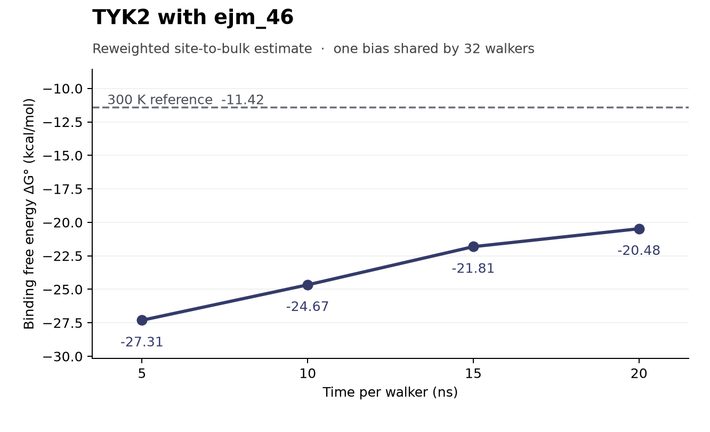

# TYK2 と A2A の共通設定を決める実験

対象は 4GIH の TYK2–ejm_46 と 5MZJ の A2A–テオフィリン。実測親和性、独立レプリカの精度、両系を完了する実時間を同じ設定で評価する。原論文を照合して推定式と候補を固定した。MD は `c163eb26` の OpenMM＋cuPotential、既存の NPT、4 fs 刻み、力場、ファネル壁、軸射影と軸距離を使う。両系とも PR #4 の平衡化済み入力から開始する。[過去の軌跡と実験結果](https://github.com/ytworks/fmeta/pull/4)

## 原論文と今回の推定式

Limongelli らはトリプシン–ベンズアミジンの Asp189 とリガンドの原子間距離にバイアスを置いた。軌跡を再重み付けして得た軸方向 PMF の 0.3～0.7 nm を積分し、3.2 nm のバルクと半径 0.1 nm の円筒断面で標準状態に換算した。結合姿勢は二つ含まれる。NPT 平衡化後の本計算は NVT。報告値 −8.5 ± 0.7 kcal/mol の誤差は終盤の標準偏差である。[原論文](https://pmc.ncbi.nlm.nih.gov/articles/PMC3631651/)・[補足資料の式と図 S3](https://www.iris.unina.it/retrieve/handle/11588/573398/41589/PNAS-2013-Limongelli-6358-63.pdf#page=9)

今回の主値は `COLVAR`・`HILLS`・`SYNC` から各 walker の受けたバイアスを再構成する。先頭 2 ns を除き、既存の時間区間別 MBAR で同じ正規化の重みを求める。区間幅の目安は 250 ps、1 レプリカあたり最大 300 区間、最大 40,000 サンプル。主積分はビンの端への依存を避けるため、各サンプルの重みを直接足す。PMF は診断用にも出力する。結合領域を B、バルクを U として

\[
K_b = \frac{\sum_{i\in B} w_i}{\sum_{j\in U}w_j/A_\mathrm{eff}(s_j)} |U|,
\qquad \Delta G^\circ=-RT\ln(K_b/1.66054\;\mathrm{nm}^3).
\]

別計算では U 内の半径 0.15 nm の円盤にあるサンプルだけを数え、円盤体積で割った濃度を分母に使う。分子は主値と同じ。累積 WT バイアスから再構成した PMF の後半平均も、同じ積分領域で報告する。円筒極限における単位と符号の照合には著者の Tcl `FFS::dg` を直接実行した。300 K、半径 0.15 nm、同じガウス井戸 PMF を使うと、井戸なしで著者 +9.14881、fmeta +9.14793、深さ 24 kJ/mol で著者 −9.40834、fmeta −9.40922 kJ/mol。解析解を持つトイ系でも検証した。[FMAP](https://doi.org/10.1038/s41596-020-0342-4)・[著者の Tcl](https://github.com/limresgrp/FMAP_v1/blob/master/funnel_gui/ffs.tcl#L1296-L1348)

## 固定した条件

| 300 K、hill 高さ 1.5 kJ/mol、bias factor 10 | 独立レプリカ × 共有 walker | σs / σρ (nm) | hill 間隔 |
|---|---:|---:|---:|
| A（過去 PR） | 4 × 8 | 0.050 / 0.100 | 1 ps |
| B | 8 × 4 | 0.050 / 0.100 | 1 ps |
| C | 8 × 4 | 0.025 / 0.030 | 2 ps |
| D（独立バイアスの文献対照） | 32 × 1 | 0.025 / 0.030 | 2 ps |
| E（TYK2で追加した32本共有） | 1 × 32 | 0.025 / 0.030 | 2 ps |

C と D の hill 条件は Evans らの軸射影・軸距離の 2 変数 fun-metaD に由来する。著者は 2 fs × 1,000 歩、今回の実装では 4 fs × 500 歩で 2 ps になる。著者の通常の fun-metaD は各軌跡が独立にバイアスを積む 500 ns 計算で、sEH 固有の体積・配向補正を使った。[本文](https://pmc.ncbi.nlm.nih.gov/articles/PMC7467642/)・[著者公開の入力](https://www.plumed-nest.org/eggs/20/012/data/fun_metaD/plumed.dat.html)

| 同じ規則で構造から固定した領域 (nm) | 結合領域 | バルク領域 | 復帰の軸閾値 |
|---|---:|---:|---:|
| TYK2 | 0.70024～2.11571 | 4.06691～4.55024 | 1.20730 |
| A2A | 0.70017～1.86530 | 4.40017～4.90017 | 1.28065 |

結晶リガンドと 0.45 nm 以内で接触するタンパク質の重原子を軸に射影し、下端壁とファネル変曲点で区間を切る。バルクは末端の既定窓から、準備後・平衡化後の構造でタンパク質、保持した補因子、脂質と周期像から相互作用カットオフを確保できる連続区間を取る。復帰閾値は共通平衡化座標から発進した 32 walker の初回 1 ps、バイアス投入前の軸座標の平均＋標本標準偏差。初速に由来する初期座標の広がりを測っている。判定には 100 ps おきの DCD で、同一 walker のポケット接触→カットオフ外のバルク→ポケット接触を確認する。フレーム間の往復を見逃す可能性がある。DCD は溶質のみで、脂質の位置は全原子の参照構造と該当時刻のチェックポイントで確認する。

## 実験開始時の判定と実行計画

以下は20 nsの結果がそろう前の計画。C・Dをいったん保留し、TYK2でEを比較した後、依頼者の指示でDを深掘りすることになった。今回の問いは、同じ短時間でどの設定が正確な ΔG° に近づきそうかである。下記の採用閾値による合否や、主推定値が全群で得られた候補だけの順位では、この問いには答えられない。

1. 各系で 8 GPU 全枚を MPS で使い、1 枚 4 プロセス、計 32 walker を同時に動かす。20、40、80、100 ns/walker を共通の評価点とする。途中点は同じ独立レプリカの累積軌跡である。
2. `device.json` と実際の `run.yaml` を照合する。全レプリカで結合域・バルク・円筒内側の再重み付けに必要なサンプルがあり、各系で構造的な往復を確認できることを求める。各群の往復数、バルク PMF のばらつき、重みの有効標本数、壁の作用を結果に残す。
3. 結合自由エネルギーは **kcal/mol** で比較する。TYK2 の化合物 46 の阻害定数は 4.8 nM、A2A-StaR2 の脂質ディスク中の解離定数は約 1.64 µM。A2A の SPR は 10 °C、原著表の丸め値は pKd 5.78。300 K の同じ換算で参照 ΔG° はそれぞれ **−11.42、−7.94 kcal/mol**。各系で予測と参照の差の絶対値、および独立レプリカの Student-t 95% 区間の半幅がともに **RT ln 5 ≈ 0.96 kcal/mol** 以下であることを求める。これは親和性の許容範囲 1/5～5 倍に対応する。解析の元データは kJ/mol で、1 kcal/mol = 4.184 kJ/mol として換算する。[TYK2 の原著](https://doi.org/10.1016/j.ejmech.2013.03.070)・[A2A の原著、表 2](https://doi.org/10.1016/j.febslet.2015.04.030)
4. まず TYK2 の全候補を同じ 20 ns/walker で比較する。独立レプリカごとに得た主推定 ΔG° の標本標準偏差（分母はレプリカ数 − 1、単位 kcal/mol）が小さい順に探索する。共有 walker は個別のレプリカとして数えない。全レプリカの推定がそろわず標準偏差を比較できない候補は後順位とし、同値の場合は候補名の順とする。実験値は探索順位や延長先を決める計算から除く。
5. この順で一つの候補に集中し、まず TYK2 を 20 → 40 → 80 → 100 ns/walker と延長する。全レプリカの試料・構造上の往復・95%区間半幅の条件を満たした段階で、その候補の A2A を保存済みチェックポイントまたは共通の平衡化構造から段階的に進める。TYK2 が100 nsに達しても半幅または往復が条件に届かなければ、全レプリカでばらつきを推定できた候補について A2A も測定して両系の結果を記録する。既測定の区間は再利用する。
6. 同じ長さの両系で試料・往復・区間半幅の条件を満たしたら、設定・領域・長さを固定して別 seed で再計算する。この独立検証の両系で項目 2・3 の全条件を満たした最初の共通設定を採用する。実験参照との一致はここで判定する。未達なら現在の候補の次の評価長へ進み、100 ns/walker でも未達なら次順位の候補を調べる。全候補で未達の場合は各例の設定を維持し、評価した範囲と結果を報告する。

当初は全候補を両系で延長した後、両系の所要時間順に独立検証する計画だった。2026-11-18、候補 C の TYK2 20 ns 完了後、D の TYK2 結果が出る前に、依頼者の指示で標準偏差を優先する TYK2 先行方式に変更した。移行前に両系で実測した A と B の結果も判定に使う。

切り替え時に C の A2A は 32 walker のチェックポイント（11.25～12.50 ns）で保留した。保存済みの他 walker の HILLS を超えて参照している SYNC 行は0件。全32本で元のエンジンの再開前検査を通した。D の20 nsは TYK2 だけを8 GPUで開始した。

同一の 20 ns における TYK2 の標準偏差は C が 2.57（8レプリカ）、A が 3.80（4レプリカ）、B が 5.83 kcal/mol（8レプリカ）。95%区間の半幅は順に 2.15、6.05、4.88 kcal/mol。独立レプリカ数が異なるため、標準偏差で順位を決め、平均値の不確かさは区間半幅として別に報告する。

実験記録 JSON の `comparison_kcal_mol.independent_replica_sd` が順位に使う標本標準偏差。`precision_passes` は全群での推定・結合・構造での往復・区間半幅の条件をまとめた探索段階の判定で、`passes` は実験参照との絶対差も含む全条件の判定。設定採用には独立検証の `passes` を使う。

PR #4 で保存した `prepared/` と `equil/` を使う場合の解析例。新たに系を準備した場合は、専用の 32 ウォーカーの 1 ps 事前計算から `paper_regions.py define` で領域を固定し、そのファイルを全候補に共通で使う。

本計算の再現例は候補 C、TYK2 の 20 ns/walker。A2A は同じ `--arm c --length-ns 20` を使い、入力・出力ディレクトリと独立な seed を替える。探索の base seed は B で 19111801 / 19211801、C で 19311801 / 19411801、D で 19511801 / 19611801（TYK2 / A2A）。既存の専用 MPS サーバーを使用する場合は、その名前とパイプを指定する。

```bash
scripts/in_docker.sh python scripts/prepare_binding_trial.py runs/r2/tyk2 runs/study/c/tyk2 \
    --arm c --length-ns 20 --seed 19311801
scripts/mps.sh start all
scripts/in_docker.sh --mps --gpus all fmeta run runs/study/c/tyk2
scripts/in_docker.sh --mps --gpus all fmeta run runs/study/c/tyk2 --length-ns 40
```

保存した A の 80 ns の主値と構造を再計算する例。

```bash
mkdir -p runs/paper-analysis
work=runs/r2/tyk2
regions=examples/tyk2_ejm46/paper-regions.json
scripts/in_docker.sh fmeta analyze "$work" --paper-regions "$regions" --length-ns 80 \
    --output runs/paper-analysis/tyk2-energy.json
scripts/in_docker.sh python scripts/paper_regions.py check "$work" --regions "$regions" \
    --length-ns 80 --output runs/paper-analysis/tyk2-structure.json
```

A2A には `runs/r2/a2a` と `examples/a2a_theophylline/paper-regions.json` を指定する。両系の JSON を `scripts/score_binding.py` に渡すと、判定理由と各レプリカの診断が得られる。

## 過去軌跡の再解析

R2 の各 10 ns の区切りには、それぞれの実行時に Docker が記録した Git コミットがある。当時の作業ツリーには未コミットの変更も記録されている。区切りごとの由来、全レプリカの主値・照合値・構造診断を機械可読の記録に収めた。[候補 A の科学的結果](../../examples/binding-study/results/a-r2.json)

| A、ns/walker | TYK2 主値 [95% 区間] (kcal/mol) | A2A 主値 [95% 区間] (kcal/mol) | DCD の復帰数 TYK2 / A2A |
|---:|---:|---:|---:|
| 20 | −16.26 [−22.31, −10.21] | −6.41 [−12.07, −0.75] | 1 / 2 |
| 40 | −13.79 [−19.12, −8.45] | −4.86 [−8.15, −1.57] | 2 / 3 |
| 80 | −10.56 [−17.07, −4.06] | −4.66 [−6.86, −2.47] | 4 / 8 |
| 90（ドリフトの確認） | −10.03 [−16.77, −3.28] | — | — |

80 ns で TYK2 は実験との差が +0.86 kcal/mol、区間の半幅が 6.51 kcal/mol。A2A は差が +3.28 kcal/mol、半幅が 2.19 kcal/mol。円盤内側による照合値は −10.56 / −4.68、同じ積分窓の後半バイアス値は −9.84 / −4.65 kcal/mol。両系とも面積補正を変えたときの差は小さい。TYK2 では独立レプリカのばらつき、A2A では参照値とのずれとばらつきが課題として残った。

80 ns のバルクフレームでタンパク質・補因子から 1 nm 確保できたのは TYK2 1,043/1,064、A2A 1,096/1,102。実際に戻った独立レプリカは両系とも 4 群中 3 群だった。結晶ポーズと平衡化直後の壁エネルギーは両系ともゼロ。軌跡中では結合側の軸閾値とポケット接触を満たすフレームのうち、TYK2 536/4,451、A2A 238/5,437 で壁が 1 kT を超えた。これらはバイアス下のフレーム数。先頭 2 ns を除き DCD の実際の接触フレームで同じ MBAR の分母を評価すると、結合区間内の全接触フレームに占める 1 kT 超の重みは各レプリカで TYK2 最大 0.0077%、A2A 最大 0.0070%。これはサンプルされた拘束下の結合領域の診断である。

## 新規8 GPU実験の結果

計算と構造確認の両方が終わった系を記載する。エネルギーの単位は kcal/mol。実験との差は予測値から300 Kの実験参照値を引いた値で、誤差・区間半幅の採用上限は各0.96 kcal/mol。

| 候補 | ns/walker | 系 | 実験参照 | 計算 ΔG° [95%区間] | 実験との差 | 区間半幅 | 構造確認した復帰 |
|---|---:|---|---:|---:|---:|---:|---|
| B | 20 | TYK2 | −11.42 | −12.24 [−17.11, −7.36] | −0.82 | 4.88 | 1回、8群中1群 |
| B | 20 | A2A | −7.94 | −5.20 [−7.34, −3.06] | +2.74 | 2.14 | 4回、8群中4群 |
| C | 20 | TYK2 | −11.42 | −16.99 [−19.14, −14.84] | −5.57 | 2.15 | 0回、8群中0群 |
| D | 20 | TYK2 | −11.42 | −13.15（29/32本の有限部分群の平均） | −1.73（部分群） | — | 1回、32群中1群 |

B の20 nsでは両系とも全8群で主値・バルク・円盤内側を推定できた。TYK2 の円盤での照合は −12.26、累積バイアスの後半平均は −11.85 kcal/mol。A2A では順に −5.17、−4.89 kcal/mol。DCDでの離脱は TYK2 19回、A2A 23回。軸座標がバルク窓に入ったフレームで溶質と1 nm以上離れていたのは TYK2 280/292、A2A 337/342だった。TYK2 は誤差の条件を満たし、区間幅が目標を超えた。A2A は誤差と区間幅の両方が目標を超えたため、B の20 nsは共通設定の独立検証候補に入らない。[候補Bのレプリカ別測定](../../examples/binding-study/results/b-screen.json)

C はBと同じ8群×4 walkerで、Evansらのガウス幅と付加間隔を使った。TYK2 の20 nsでは、95%区間半幅がBの4.88から2.15 kcal/molに縮まり、実験値との絶対差は0.82から5.57 kcal/molに増えた。円盤内側の推定は −16.97、累積バイアスの後半平均は −16.69 kcal/mol。全32 walkerでバルクへの離脱を19回確認したが、100 ps間隔の構造記録でポケットへの復帰を確認できた群はなかった。[候補Cのレプリカ別測定](../../examples/binding-study/results/c-screen.json)

D の TYK2 は、独立した1本のバイアス履歴を持つ計算を32回行った。1本でも結合自由エネルギーを推定でき、1本だけを対象にしたレプリカ間の標準偏差は定義できない。Limongelli らは1軌跡内で結合・離脱の往復と ΔG° の時間推移を評価した。バルクの10ビンすべてでの観測と円盤内側での照合は今回の追加診断である。[原論文の図S3・S4に関する説明](https://pmc.ncbi.nlm.nih.gov/articles/PMC3631651/)・[著者によるPMF積分の実装](https://github.com/limresgrp/FMAP_v1/blob/master/funnel_gui/ffs.tcl#L1296-L1348)

D・20 ns の再重み付け主推定値は **29/32本** で有限、円盤内側の照合値は **28/32本** で有限、バルク10ビンの観測などを含む診断を通ったのは **23/32本** だった。rep16・17・24では2 ps間隔の全記録を確認してもバルク観測が0件で、観測比から有限の主推定値を得られない。残り6本では主推定値を報告できるが、バルクを観測したのは各3～32サンプルである。構造記録では離脱25回、復帰1回（rep21）。[候補Dのレプリカ別測定](../../examples/binding-study/results/d-screen.json)

各1本のWTバイアスから再構成した自由エネルギー面を同じ結合・バルク区間で積分すると **32/32本** で有限の推定値が得られた。20 ns終点における32本の平均は **−12.04 kcal/mol**、標本SDは **5.17 kcal/mol**。各1本の後半平均（11～20 ns）を使うと **−13.20 kcal/mol**、標本SDは **4.72 kcal/mol**。バルク訪問がない場合にもこの積分は数値を返す。例えば復帰を確認したrep21の値は5、10、15、20 nsで −12.95、−10.03、−9.77、−9.77 kcal/mol。rep16の20 nsの値は −20.05 kcal/molだが、その1本でバルクの平坦な自由エネルギー面を確かめる観測は得られていない。

当初は主推定値が全レプリカで得られた候補の間で標準偏差を比較し、C・TYK2を40 nsまで延長する計算を開始した。Dには1本ごとに別途算出できる推定値があり、この比較だけで延長先を決めるには不十分だった。計算は再開可能な状態で保留し、Dを含む全候補を修正した解析で再評価した。

## C・DのWTバイアス面による照合

同じ TYK2、20 ns/walker、全32 walker で比較した。WTバイアス面による単一履歴の積分は両候補の全独立群で得られる。各群の11～20 nsの平均、その平均の独立群間の標本SDと Student-t 95%区間半幅、20 ns終点での群平均とのずれを示す。エネルギーの単位は kcal/mol。

| TYK2・20 ns | 独立群 × walker | 各群の後半平均のSD | 群平均の95%区間半幅 | 終点と後半の群平均の絶対差 | ポケットへの構造上の復帰 |
|---|---:|---:|---:|---:|---:|
| C | 8 × 4 | 2.45 | 2.05 | 2.32 | 0回 |
| D | 32 × 1 | 4.72 | 1.70 | 1.16 | 1回 |

C は独立群間のばらつきが小さい。D は同じ32本の計算からより多くの独立履歴を得られ、系全体の平均の区間が狭く、終点と後半平均の差が小さかった。D のサンプリング診断を通った23本でも、この差は1.60 kcal/molだった。

| TYK2 の WT 積分、kcal/mol | C | D |
|---|---:|---:|
| 11～20 nsの群平均 | −16.69 | −13.20 |
| 11～20 nsの群平均と実験参照の絶対差 | 5.27 | 1.78 |
| 20 ns終点の群平均 | −14.36 | −12.04 |
| 20 ns終点の群平均と実験参照の絶対差 | 2.94 | 0.62 |

当初この照合を根拠にDが有望とした判断は取り下げた。短時間の設定の精度は、下記の「TYK2の1レプリカ × 32 walker 実験」の表で、全候補に同じ主推定式を適用して比較する。20 nsの主推定ではC全8群の平均が −16.99 kcal/mol、Dの有限な29本だけの平均が −13.15 kcal/mol。Dには残る3本の主推定がなく、WT照合値で代入すると推定式が混在する。A2AではA・Bの20 nsが完了し、C・Dの20 nsの結果はまだない。

各独立群で「20 ns終点 − その群の後半平均」を取り、CとDの差を評価すると、平均差は +1.16 kcal/mol、Welch の95%区間は −0.36～+2.69 kcal/molだった。群間のばらつきを考慮すると、Dのほうが時間的に安定という判断の確度は低い。


## 自由エネルギー面の探索範囲と32 walker共有の見込み

TYK2で先頭2 nsを除いた各候補288,000点の軸射影・軸距離を、同じ原点と同じ格子幅（0.025 × 0.030 nm）で比較した。面積は訪問したセルが占める集団変数空間の面積である。[格子幅を半分・2倍にした比較を含む全測定](../../examples/binding-study/results/tyk2-20ns-cv-coverage.json)

| 2～20 nsの観測範囲 | C（8群 × 4 walker） | D（32群 × 1 walker） |
|---|---:|---:|
| 全32軌跡を重ねた面積（nm²） | 2.168 | 2.015 |
| 1枚の独立バイアス面の面積、中央値（nm²） | 1.989 | 1.332 |
| 同じ4軌跡をまとめた面積、中央値（nm²） | 1.989 | 1.697 |
| 軌跡1本の面積、中央値（nm²） | 1.103 | 1.332 |
| 結合域とバルクの両方を訪問した軌跡 | 19/32 | 29/32 |

4軌跡をまとめたときには、バイアスを共有したCがより広く探索した。一方、32本を通じたバルク観測数はほぼ同じ（C 10,505点、D 10,519点）で、Dではより多くの軌跡に観測が分散した。ΔG° は結合域とバルクの相対的な重みで決まるため、訪問面積だけから誤差を予測することはできない。

1群の32 walkerが1枚のバイアス面を共有すれば、同期時に読み込んだ他のwalkerの探索が後続の運動に反映される。C・Dと同じ1本あたり2 psのhill付加間隔では、1枚あたりの付加回数はCの8倍になる。WTでは個々のhillの高さがその時点のバイアスに依存する。Cの8枚を事後に重ねて得た面積から、最初から32本が同じバイアスで動いた場合の ΔG° を再構成することはできない。このためTYK2で条件Eを実測した。[過去の1群8本の実験](2026-11-17-example-settings.md)・[multiple-walker metadynamics の原論文](https://pubmed.ncbi.nlm.nih.gov/16494409/)

TYK2では同じ力場・エンジン・hill条件で、32本共有の1枚から5・10・15・20 ns時点の ΔG° を求めた。値の推移と結合域・バルクの往復を既存のC・Dと照合した。1回の計算ではレプリカ間SDは定義できない。両系の共通設定としての評価にはA2Aでの測定も必要である。

## TYK2 の1レプリカ × 32 walker 実験（E）

2026-11-18にTYK2だけで開始した。初速のbase seedは19711801。C・Dと同じ平衡化構造、力場、エンジン、領域、hill高さと幅、付加間隔を使用する。全32 walkerが1つのバイアスを共有する。5、10、15、20 ns/walkerで全32本をそろえてその時点の軌跡を保存し、同じチェックポイントから続ける。

主推定の結合自由エネルギー ΔG° は、結合域とバルク域の再重み付け後の観測比から求める。表の絶対差は各時点の主推定と300 Kの実験参照（−11.42 kcal/mol）との差である。1本の共有バイアス履歴でも主推定値は得られ、履歴間SDと95%区間は定義されない。[各時点の主推定と照合値](../../examples/binding-study/results/e-tyk2.json)

| ns/walker | C の ΔG°（有限群 / 8） | D の ΔG°（有限群 / 32） | E の ΔG°（1群） | E と参照との絶対差 |
|---:|---:|---:|---:|---:|
| 5 | 算出不可（0/8） | 算出不可（0/32） | −27.31 | 15.89 |
| 10 | −20.35（8/8） | −10.32（7/32） | −24.67 | 13.25 |
| 15 | −18.85（8/8） | −13.04（20/32） | −21.81 | 10.40 |
| 20 | −16.99（8/8） | −13.15（29/32） | −20.48 | 9.06 |

表はすべて同じ主推定式、単位はkcal/mol。Dは有限の値が得られた本数が時点ごとに異なり、値はその部分群の平均である。5 nsのC・Dではバルクの観測がなく、観測比を計算できない。Cの短い評価点は連続計算から事後に切ったため、先行walkerの履歴が一部の試料に入る。10 nsでは最大11.27 ns、15 nsでは最大16.90 ns。20 nsでは後続区間の履歴は0件。C・Dとも20 nsの有限・欠測の判定は既存PRと全群で一致し、有限の値の再計算差は最大でも0.000001 kcal/mol未満だった。[C・Dの主推定値、算出数、バイアス履歴の照合](../../examples/binding-study/results/tyk2-cd-primary-checkpoints.json)

5 nsから10 nsで主推定は2.64 kcal/mol参照値に近づいた。元のWTバイアス面の直接積分は独立の照合法で、同じ10 nsにおけるその終点は −20.15 kcal/molである。バルクに到達したwalkerは5 nsで3本、10 nsで7本。10 nsまでにポケットへの復帰は確認されていない。補助診断には時点ごとの探索範囲も記録した。[Eの訪問面積](../../examples/binding-study/results/e-tyk2-cv-coverage.json)・[同じ時点のC・Dの訪問面積](../../examples/binding-study/results/tyk2-cd-cv-coverage-checkpoints.json)

Eの主推定は10 nsから15 nsで2.85 kcal/mol、15 nsから20 nsで1.34 kcal/mol参照値に近づいた。20 nsでの値は −20.48 kcal/molで、バルクへの離脱10回、ポケット復帰0回。20 nsまでの結果は結合自由エネルギーの収束を示すには十分でない。

| TYK2の観測時点 | C 全訪問面積 | D 全訪問面積 | E 全訪問面積 | C 両域に到達した本数 | D 同左 | E 同左 |
|---:|---:|---:|---:|---:|---:|---:|
| 5 ns | 1.467 | 1.055 | 1.964 | 0 | 0 | 1 |
| 10 ns | 2.058 | 1.857 | 2.180 | 9 | 7 | 5 |
| 15 ns | 2.120 | 1.944 | 2.240 | 14 | 20 | 8 |
| 20 ns | 2.168 | 2.015 | 2.279 | 19 | 29 | 9 |

全訪問面積は物理walker 32本の和集合（nm²）。両域到達には、同じ物理walkerについて先頭2 nsを除いた区間内に結合域とバルク域の両方の記録が必要である。構造から数えるポケット復帰には、バルクを経た後の接触回復も必要である。[C・Dの時系列](../../examples/binding-study/results/tyk2-cd-cv-coverage-checkpoints.json)・[Eの時系列](../../examples/binding-study/results/e-tyk2-cv-coverage.json)

| TYK2・20 ns、面積（nm²） | 全訪問セル | 5記録以上のセル | 異なる2本以上の訪問セル | 同条件の結合域 | 同条件のバルク |
|---|---:|---:|---:|---:|---:|
| C | 2.16825 | 2.10000 | 2.11575 | 1.03870 | 0.13194 |
| D | 2.01450 | 1.93125 | 1.84200 | 0.85065 | 0.12744 |
| E | 2.27850 | 2.20875 | 2.13375 | 1.02382 | 0.14645 |

Eの全訪問面積はCを5.08%上回る。異なる2本以上が訪れた面積では差は0.85%に縮まり、結合域でこの条件を満たす面積はCが最大だった。5記録の条件は同じwalkerの連続観測でも満たせる。共有バイアスを使った2本は独立レプリカとしての反復には数えない。[全領域・結合域・バルクの格子点数と面積](../../examples/binding-study/results/tyk2-20ns-repeated-cv-visits.json)

### 同じ20 nsでの全候補の比較

ΔG°、実験参照との絶対差、独立群間の標本SDはすべてkcal/mol。TYK2の実験参照は −11.42、A2Aは −7.94 kcal/mol。DのSDは有限な29本のみから求めた標本SDである。Eでは32本がバイアスを共有し、独立群は1つである。

| 候補（独立群 × walker） | TYK2 ΔG° | TYK2 絶対差 | TYK2 群間SD | TYK2 有限群 | TYK2 ポケット復帰 | A2A ΔG° | A2A 絶対差 | A2A 群間SD |
|---|---:|---:|---:|---:|---:|---:|---:|---:|
| A（4 × 8） | −16.26 | 4.84 | 3.80 | 4/4 | 1回 | −6.41 | 1.53 | 3.56 |
| B（8 × 4） | −12.24 | 0.82 | 5.83 | 8/8 | 1回 | −5.20 | 2.74 | 2.56 |
| C（8 × 4） | −16.99 | 5.57 | 2.57 | 8/8 | 0回 | 未測定 | — | — |
| D（32 × 1） | −13.15 | 1.73 | 5.78 | 29/32 | 1回 | 未測定 | — | — |
| E（1 × 32） | −20.48 | 9.06 | 定義不可 | 1/1 | 0回 | 未測定 | — | — |

探索面積は原点 (0, 0) の 0.025 × 0.030 nm の格子で、各系の計算格子端と領域境界で切り取った。全7条件とも全32本について (2, 20] ns に共通の2 ps周期で残した288,000点を使用した。TYK2では計算格子の軸方向は0.40024～4.95024 nm、半径方向は0～1.01222 nm。A2Aでは0.40017～5.30017 nm、0～1.03621 nm。面積は実際に訪問したセルの和で、自由エネルギー値の収束を表す量ではない。

| 系と条件 | 軸方向の実測範囲（nm） | 半径の実測最大（nm） | 全体の面積 | バイアス1枚の面積¹ | 軌跡1本の面積¹ | 結合域の面積 | バルクの面積 | バルク到達／両域到達² | 構造上の離脱／復帰 |
|---|---|---:|---:|---:|---:|---:|---:|---:|---:|
| TYK2 A | 0.578–4.772 | 0.817 | 2.226 | 2.112 | 0.843 | 1.067 | 0.143 | 16／13 | 16／1 |
| TYK2 B | 0.592–4.774 | 0.813 | 2.178 | 1.866 | 0.977 | 1.052 | 0.140 | 20／20 | 19／1 |
| TYK2 C | 0.596–4.738 | 0.804 | 2.168 | 1.989 | 1.103 | 1.050 | 0.136 | 19／19 | 19／0 |
| TYK2 D | 0.620–4.728 | 0.753 | 2.015 | 1.332 | 1.332 | 0.978 | 0.129 | 29／29 | 25／1 |
| TYK2 E | 0.580–4.759 | 0.819 | 2.279 | 2.279 | 0.336 | 1.080 | 0.150 | 10／9 | 10／0 |
| A2A A | 0.575–5.125 | 0.817 | 2.703 | 2.556 | 0.986 | 0.948 | 0.159 | 17／10 | 17／2 |
| A2A B | 0.598–5.117 | 0.821 | 2.657 | 2.401 | 1.291 | 0.939 | 0.157 | 23／20 | 23／4 |

¹ 面積単位はnm²。バイアス1枚・軌跡1本の値は群・walker別面積の中央値。² 到達は32本中の物理walker数。TYK2でEの面積が最大なのは全軌跡を重ねたときと1枚の共有バイアスを見たときで、1本ずつではDの中央値が最大だった。Eの半径最大は0.819 nm、観測の99パーセンタイルは0.719 nm。Aの99パーセンタイルは0.738 nmだった。[実測軸・半径の分布](../../examples/binding-study/results/20ns-cv-ranges.json)・[A・Bの観測周期と面積](../../examples/binding-study/results/ab-20ns-cv-coverage.json)・[C・Dの面積](../../examples/binding-study/results/tyk2-cd-cv-coverage-checkpoints.json)・[Eの面積](../../examples/binding-study/results/e-tyk2-cv-coverage.json)

A・Bの20 nsではA2Aも全独立群で主推定が得られた。TYK2で最も近いBはこの系での群間SDが大きく、A2Aでの参照との差は2.74 kcal/mol。Cは全8群で値がそろい群間SDが小さいが、TYK2での参照との差は5.57 kcal/mol。Dの有限部分群の平均はCより参照に近い。[候補Aの測定](../../examples/binding-study/results/a-r2.json)・[候補Bの測定](../../examples/binding-study/results/b-screen.json)



同じ準備済み入力を使ってEを再現するコマンド。各区間の解析はその時点の保存済み軌跡に実行する。

```bash
scripts/in_docker.sh python scripts/prepare_binding_trial.py runs/r2/tyk2 runs/study/e/tyk2 \
    --arm e --length-ns 5 --seed 19711801
for cut in 5 10 15 20; do
    scripts/in_docker.sh --mps --gpus all fmeta run runs/study/e/tyk2 --length-ns "$cut" || exit 1
done
```

## 主推定ΔG°の検証

**報告値の変更履歴。** Eの10 nsを最初に公開した時点で、再重み付けによる主推定は −24.66605 kcal/mol、WT面の終点積分は −20.15131 kcal/molだった。4.51474 kcal/molの差は二つの推定法の違いで、途中報告で照合値を主結果のように示した点を訂正した。これとは別に、過去のA～Dの再重み付け解析で、バイアスの格子点間補間を双線形から本計算で実際に使った自然双三次スプラインに修正した。TYK2・20 nsで主推定平均の変化はA −0.01226、B −0.00574、C −0.01221 kcal/mol。Dの有限な29本では個別変化の絶対値が最大0.02585 kcal/molだった。各系の入力、エンジン履歴、seed、算出可能群を版ごとに突き合わせた。[公開コミット・入力・数値の変更履歴](../../examples/binding-study/results/tyk2-estimator-audit.json)

**式と単位。** 結合域の確率をバルクの体積あたり確率密度で割ると、結合定数の単位はnm³になる。バルクが平坦な半径一定の硬い円筒では、原論文の軸方向PMFの積分に円筒断面積を掛けた式に帰着する。1 Mの標準体積は1分子あたり1.660539067 nm³。今回の軌跡解析は、時間区間ごとのバイアスを固定と近似したMBARで重みを推定する。MBARの原論文が扱うのは平衡分布から得た試料であり、時間依存バイアスに対するこの近似は別途検証が必要である。[ファネル法の原論文](https://pmc.ncbi.nlm.nih.gov/articles/PMC3631651/)・[MBARの原論文](https://pmc.ncbi.nlm.nih.gov/articles/PMC2671659/)

| 理論値を独立に求められる系（kcal/mol） | 理論値 | 主推定 | 絶対差 |
|---|---:|---:|---:|
| 硬い円筒、井戸なし | +2.092809 | +2.092809 | 0.000000025未満 |
| 硬い円筒、井戸の深さ6 kT | −1.484159 | −1.484159 | 0.000000025未満 |
| 異なる2つのバイアスから既知の結合域・バルクの確率比6を復元 | +1.120221 | +1.120221 | 0.000000025未満 |
| 三次元ガウス井戸、独立な座標積分 | −1.130812 | −1.130845 | 0.000034未満 |

さらに、既知ポテンシャルを実際に20 nsシミュレーションした1レプリカでは、ガウス井戸の主推定 −1.26638 に対して理論値 −1.18238 kcal/mol。井戸なしでは主推定 −0.32107 に対して理論値 −0.16610 kcal/molで、結合なしと判定された。有限の軌跡には、数値積分そのものより大きいサンプリング誤差が生じる。[理論値4件の検算](../../examples/binding-study/results/binding-oracles.json)・[既知ポテンシャルの軌跡2件の結果](../../examples/binding-study/results/known-potential-trajectories.json)

**TYK2の実軌跡の独立検算。** 本解析を一切importしない実装で、共有HILLSのチェックサムから各walkerが受けたバイアスを復元した。ガウス和、格子点間の自然三次スプライン、MBARの固定点方程式、円筒の半径方向積分をそれぞれ別計算し、標準状態に換算した。Cの20 ns全8群、Dの20 ns全32本、Eの4評価点を検査した。有限な41件は最大0.000000048 kcal/molの差で一致し、Dの残る3本は両実装でバルク観測0件だった。Eの20 nsの差は0.000000036 kcal/mol未満。768点で軌跡が記録した瞬時バイアスとも照合した。動径を正則化した厳密な面積で積分した場合の影響は最大0.000015 kcal/mol未満だった。この検算は同じデータ・同じ時間分割における数値の再現性を確認するもので、真の平衡親和性への収束は別の問いである。[全44件の独立検算と数値差](../../examples/binding-study/results/tyk2-independent-primary-replay.json)・[独立実装](../../scripts/audit_binding_reweight.py)

### 解析の時間分割・試料数を統一した検証

上の主推定表は最初に設定した1群あたり最大300区間・40,000試料で求めた。同じ式でも、この上限の実際の影響は群構成ごとに違う。TYK2の20 nsにおいてC・Dは各walkerの先頭2 nsを除く全9,000点を使い、各walkerのバイアスを250 psごとに評価した。Eでは当初、1つの共有群に288,000点が集まり、8点ごとに1点の36,000点を使用した。バイアスの評価も各walker 9区間、1区間2 nsだった。

同じ固定軌跡から全候補の各walkerを250 ps区間で解析し、記録された全試料を使用する。既にこの条件に一致しているC・Dは上表と同じ値である。Eの再現例では、解析プロセスだけで区間数と試料数の上限を十分に引き上げる。ここで指定する workdir は、評価時点の全walkerがそろった保存済みの軌跡である。

```bash
scripts/in_docker.sh python -c '
import sys
import fmeta.analysis as analysis
from fmeta.cli import main
analysis.MAX_SLICES = 2304
analysis.MAX_SAMPLES = 320000
main(sys.argv[1:])
' analyze runs/study/e/tyk2 --paper-regions examples/tyk2_ejm46/paper-regions.json \
    --length-ns 20 --discard-ns 2 --output runs/e-20ns-full-samples.json
```

| E・ns/walker | 最初に公開した ΔG° | 250 ps区間・全試料の ΔG° | 後者 − 前者 | 全試料数 |
|---:|---:|---:|---:|---:|
| 5 | −27.310 | −27.275 | +0.035 | 48,000 |
| 10 | −24.666 | −24.408 | +0.258 | 128,000 |
| 15 | −21.815 | −22.252 | −0.437 | 208,000 |
| 20 | −20.477 | −20.447 | +0.029 | 288,000 |

20 nsのEで、2 ns区間のまま全28.8万点を使うと −20.4760 kcal/mol。3.6万点のまま250 ps、125 psに刻むとそれぞれ −20.4472、−20.4501 kcal/mol。20 nsの各候補を250 ps区間・全試料でそろえた値は次のとおり。

| 系 | A ΔG°（SD） | B ΔG°（SD） | C ΔG°（SD） | D ΔG°（SD） | E ΔG° |
|---|---:|---:|---:|---:|---:|
| TYK2 | −16.26（3.83） | −12.24（5.83） | −16.99（2.57） | −13.15（5.78、有限29本） | −20.45（独立1群） |
| A2A | −6.37（3.57） | −5.20（2.55） | 20 ns未完了 | 未測定 | 未測定 |

EとTYK2参照の20 nsの差はこの条件で9.03 kcal/mol。変化するバイアスの区間幅と試料の間引きを個別に変更しても20 nsの差は残り、15 nsでは区間設定に0.44 kcal/molの感度があった。[全候補の群別数値、区間数、試料数](../../examples/binding-study/results/binding-resolution-sensitivity.json)

## Dを深掘りする実験

TYK2で32本が各自のバイアスを積むDを優先する。20 nsで単一軌跡の訪問面積の中央値と両域への到達本数が最大で、独立な初速度による推定値の分布も測れる。次の評価点を25、30、35、40 ns/walkerに置き、TYK2の既存の全32本から継続する。hill条件、エンジン、領域、初速度は固定する。各時点で同一の主推定を使い、有限本数、全群または有限部分群の平均、標本SD、同じ軌跡の前時点からの変化、探索面積、バルクへの到達と構造上の復帰を比較する。実験参照に近かった初速度だけを抜き出すとばらつきを過小評価するため、32本の個別値と欠測理由を維持する。TYK2で候補長を絞り、A2Aでも同じ物理条件と長さで精度を測る。

| TYK2・Dの時間区間 | 有限なレプリカ数の変化 | 各時点の有限群平均の変化 | 両時点で有限な群の平均変化 | 同じ群の変化の絶対値の中央値 |
|---|---:|---:|---:|---:|
| 10 → 15 ns | 7 → 20 | −2.72 | +1.63（7群） | 1.62 |
| 15 → 20 ns | 20 → 29 | −0.11 | +1.45（20群） | 1.51 |

単位はkcal/mol。15 → 20 nsで新たに有限となった9群の平均は −16.62 kcal/mol。先に値が得られた20群の変化を相殺したため、異なる有限部分群を比べると安定したように見えた。20 nsでバルクの再重み付けによる有効標本数（Kish ESS）が100以上ある21群に限っても、主推定の標本SDは4.86 kcal/molある。ESSは重みの集中度を測り、時系列の自己相関を補正する量ではない。短時間でバルクを訪れた群だけを使うと訪問しにくい初速度が欠落する。新規区間でも同じ群の変化と新規に有限になった群の寄与を確認する。[各群のドリフト・有効標本数・分散](../../examples/binding-study/results/tyk2-d-historical-diagnostics.json)

| TYK2・D | ΔG° | 参照との絶対差 | 群間SD | 有限群 | 前評価点と同じ群の変化の絶対値の中央値 | 全体／各軌跡の面積¹ | 結合域・バルク両方を訪問 | 構造上の離脱／復帰 |
|---|---:|---:|---:|---:|---:|---:|---:|---:|
| 20 ns | −13.15 | 1.73 | 5.78 | 29/32 | 1.51（20群） | 2.015／1.332 | 29 | 25／1 |
| 25 ns | −11.85 | 0.43 | 5.33 | 29/32 | 1.12（29群） | 2.114／1.461 | 29 | 29／3 |

¹ 面積はnm²、各軌跡では32本の中央値。ΔG°、参照との差、変化量、SDの単位はkcal/mol。20・25 nsで有限なのは同じ29群で、rep16・17・24は両時点ともバルク観測0件。25 nsの29群の平均変化は +1.30 kcal/mol。構造上の復帰は異なる3本で各1回。各群の (2, 25] nsの11,500観測を250 psの92区間で再重み付けした。[延長各時点の全群の値・重み・空間探索](../../examples/binding-study/results/d-tyk2-checkpoint-scan.json)

25 nsの保存点で生のHILLSとCOLVARから独立実装が得た有限29群の平均は −11.850955 kcal/mol。群ごとの差の最大は 5.98 × 10⁻⁸ kcal/mol、残る3群のバルク観測0件も一致した。[Dの延長軌跡の独立検算](../../examples/binding-study/results/tyk2-d-extension-independent-replay.json)
